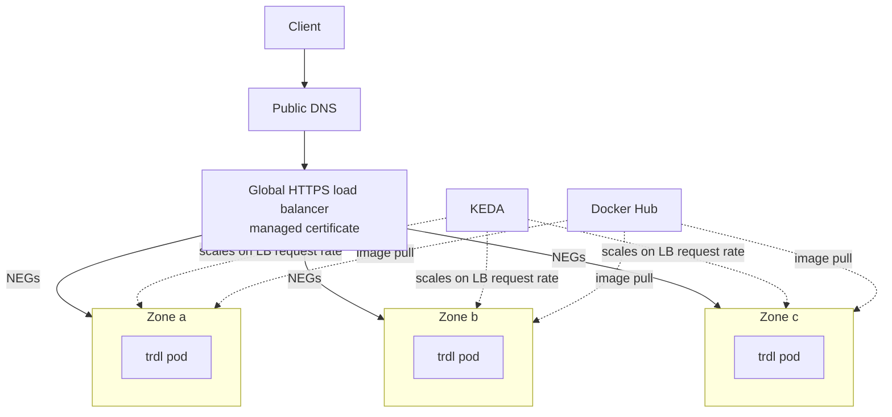
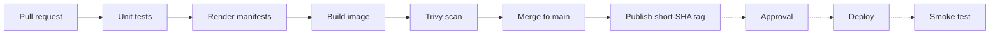

# Solution

## Scope

The service itself is trivial (`GET /` returns `42`). The work is in showing a credible path to running it as a highly available production service in a public cloud: container, Kubernetes manifests, CI, autoscaling and operations.

Everything runs on a local k3d cluster. The GKE setup is a reference overlay that CI renders but nothing deploys, because no cloud account is assumed. Tasks and time estimates are in [discovery.md](discovery.md).

## Architecture

Target production flow on GKE:

Delivery flow (the approval and deploy steps are the intended next stage, not implemented):

## Technology choices

| Area | Choice | Reason |
|---|---|---|
| Application | Go standard library | No dependencies, fast startup |
| Container | Multi-stage build, distroless, non-root | Small attack surface, no shell |
| Configuration | Kustomize: one base, `local`, `local-keda` and `gke` overlays | Native to kubectl, no extra packaging layer |
| Local cluster | k3d (1 server, 2 agents) | Reproducible Kubernetes without cloud access |
| Autoscaling | KEDA on request rate | CPU says little for a constant-response service |
| CI | GitHub Actions | Lives with the code |
| Registry | Docker Hub | No cloud account needed |
| Cloud target | Regional GKE | Regional control plane, nodes in three zones |

## Availability

The base Deployment runs 2 replicas behind a Service that only routes to ready pods. Rolling updates use `maxUnavailable: 0`. The process handles SIGTERM, and a 2-second `preStop` sleep lets endpoints update before shutdown. Liveness (`/healthz`) and readiness (`/readyz`) are separate so that if dependencies are added later, readiness can reflect them without a remote outage triggering restarts.

The `gke` overlay adds what a multi-zone setup needs:

| Concern | Implementation |
|---|---|
| Zone spread | 3 replicas with a hard topology spread on `topology.kubernetes.io/zone` (`maxSkew: 1`): a zone outage removes at most a third of the pods. Soft spread across nodes within a zone. |
| Disruptions | PodDisruptionBudget: at most one pod down during node upgrades and drains. |
| Load balancing | GKE Ingress (`gce`) with a global external Application Load Balancer; container-native load balancing (NEGs) sends traffic straight to pods in every zone. |
| Health checks | BackendConfig: load balancer health check on `/readyz`, 10 s connection draining. |
| TLS | Google-managed certificate; plain HTTP disabled. |

Replicas alone don't establish an SLA. Availability also depends on DNS, the load balancer, the control plane, node pools, the registry and the operational response, and an SLA needs an agreed measurement window and error budget. See the downtime table in [operations.md](operations.md#slo-discussion).

## Autoscaling

KEDA scales the Deployment on requests per second, creating and owning the HPA:

- **Locally** (`local-keda`), it reads Traefik's request rate from a small Prometheus: one replica per 100 req/s, 2 to 6 replicas. A k6 load test at 400 req/s scaled it from 2 to 4 and back with 0 failed requests out of 44,150 ([run details](operations.md#autoscaling-demo-with-keda-k3d)).
- **On GKE**, it reads the load balancer's request count from Cloud Monitoring (through Workload Identity, no keys), with CPU as a second trigger, between 3 and 9 replicas, so there is always one pod per zone.

Without a fallback, KEDA freezes at the current replica count when its metric source is down, which was observed locally with Prometheus stopped. Both ScaledObjects therefore set `fallback`: after 3 failed reads, KEDA runs a fixed safe count (4 locally, 6 on GKE). This was tested locally. Scale-to-zero is not used, because it would remove the warm replicas that the availability goal depends on.

The cost is two more components to run and upgrade (the KEDA operator and its metrics API server), and the scaling now depends on the metrics pipeline.

## Delivery

CI tests, renders every overlay, builds, scans, and on `main` publishes an immutable short-SHA tag, which `/version` also reports. It does not deploy: a hosted runner can't reach a laptop cluster, and no cloud credentials are assumed. A real GKE pipeline would add a protected deploy job using Workload Identity Federation (no long-lived keys), an environment approval and a post-rollout smoke test.

## Testing

- **Unit tests:** `/` body and content type, `404`, `405` with `Allow`, health, readiness and version endpoints.
- **Demonstrated on k3d:** scaling up and down under load with no failed requests, and the KEDA fallback when Prometheus is down.
- **Still to do:** request continuity during a rolling update (the k6 Job can drive it), pod deletion and replacement, and a smoke test against the external endpoint.

## Monitoring

Indicators to track: success ratio, request rate, 5xx rate, latency (p50, p95, p99), pod readiness and restarts. Alerts should fire on user-visible symptoms (5xx rate, latency, unavailable replicas), not on CPU. On GKE, logs go to Cloud Logging from stdout; OpenTelemetry is the natural choice if tracing is needed.

## Security

In place: a non-root distroless image, `seccomp: RuntimeDefault`, resource limits, no secrets in the app, Trivy scanning in CI, and immutable image tags.

Before production: image signing and provenance, dependency update automation, network policies, least-privilege IAM, an admission policy, and a documented patch process.

## Limitations and next steps

1. k3d has one control-plane server and no real zones. It demonstrates scheduling and recovery, not regional high availability.
2. The GKE overlay has never been applied. Its hostname, static IP and project ID are placeholders, and the Cloud Monitoring filter is unverified.
3. The 100 req/s per replica threshold is a demo value, not measured. Resource requests and limits are also starting values.
4. CI renders the manifests but doesn't validate them against KEDA or GKE schemas.

Next steps: provision a regional GKE cluster, set up CI identity, deploy the `gke` overlay, run failure and load tests there, and agree SLOs before committing to an availability target.
